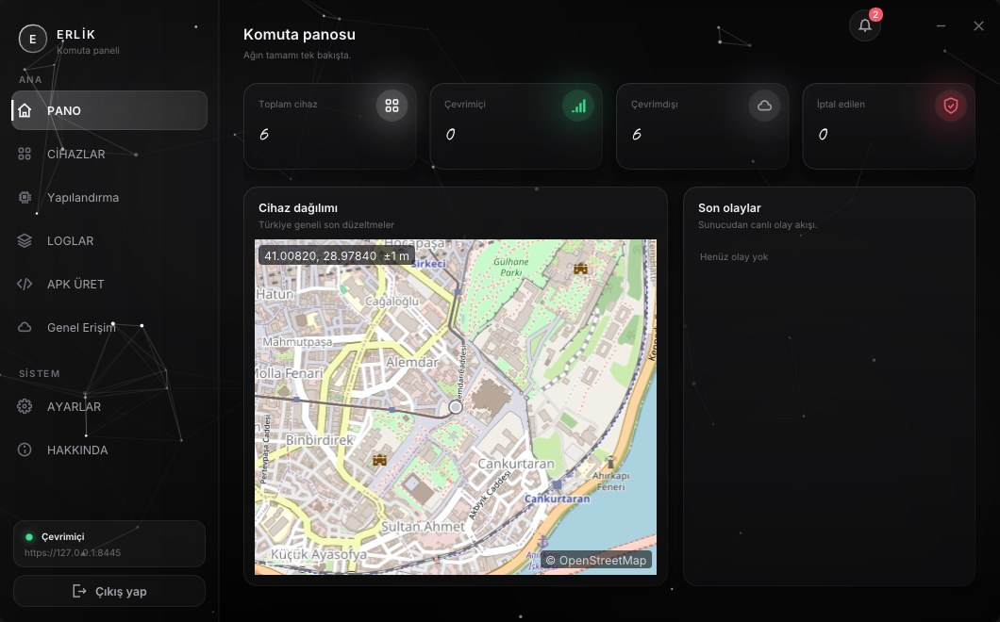

<p align="center">
  
</p>

<h1 align="center">ERLİK · tanıtım dosyası</h1>

<p align="center">
  <strong>Kâğıt-mürekkep bir operatör dosyası gibi davranan tek sayfalık site.</strong><br>
  Android filo komuta panelinin tanıtımı, kurulumu, bağlantı rehberi ve sorun giderme tablosu.
</p>

<p align="center">
  
  
  
  
</p>

<p align="center">
  <a href="https://memati8383.github.io/erlik-site/"><strong>Canlı site →</strong></a>
  &nbsp;·&nbsp;
  <a href="https://erlik-panel.erlik-menu.workers.dev/">Cloudflare kopyası</a>
  &nbsp;·&nbsp;
  <a href="https://github.com/Memati8383/erlik">Panel deposu</a>
</p>

<p align="center">
  
</p>

---

## Ne bu depo

`erlik-site`, [ERLİK](https://github.com/Memati8383/erlik) masaüstü panelinin tanıtım
sitesidir. Tek HTML sayfası, dokuz bölüm, sıfır çatı: React, Tailwind, paket yöneticisi
ya da derleme adımı yok. Dosyalar olduğu gibi servis edilir.

| # | Bölüm | Ne anlatır |
|---:|---|---|
| 01 | Nedir | Panelin ne olduğu, neyin üzerine kurulduğu, neyi çözmediği |
| 02 | Özellikler | 14 modülün tek satırlık iş tanımı, numaralı dizin |
| 03 | Kurulum | `build.bat`, MSVC gereksinimleri, beklenen çıktı |
| 04 | Bağlantı | Sunucu adresi, LAN modu, parola ve oturum akışı |
| 05 | Kullanım | İlk açılış, cihaz seçimi, günlük akış |
| 06 | Komutlar | Komut tipleri ve argüman şablonları |
| 07 | Sorun giderme | Belirti → neden → çözüm tablosu |
| 08 | SSS | Açılır kapanır sorular |
| 09 | Lisans ve iletişim | Kullanım sınırı, geliştirici, imza |

Metin, panelin kendi README'siyle aynı kaynaktan beslenir; sürüm, port ve bayrak
bilgileri oradan gelir.

---

## Tasarım dili

Site bir *broşür* gibi değil, **masaya bırakılmış bir operatör dosyası** gibi okunur:
kâğıt zemin, mürekkep tipografi, hairline çizgiler ve tek bir mühür rengi.

| Belirteç | Değer | Kullanım |
|---|---|---|
| `--paper` | `#e9ebe5` | Kâğıt zemini (`dark` temasında `#141715`) |
| `--ink` | `#161a17` | Gövde ve başlık mürekkebi |
| `--ink-2` / `--ink-3` | `#47514a` / `#5a645c` | İkincil metin, mono dipnotlar |
| `--rule` / `--rule-2` | `#c3c9bf` / `#a9b2a6` | Hairline çizgiler, tablo kenarları |
| `--stamp` | `#1d3fae` | Tek vurgu: mühür mavisi (etiket, bağlantı, odak) |
| Köşe yarıçapı | `2px` | Her kutu, düğme ve plaka |
| Ölçü | `--maxw: 1220px` | İçerik sütunu |
| Tipografi | IBM Plex Sans · IBM Plex Mono | Yerel `woff2`, `latin` + `latin-ext` |

Gradyan yok, cam efekti yok, parıltı yok. Renkli tek şey mühür ve ekran
görüntülerinin kendisi.

### Yüzeyler

| Öğe | Davranış |
|---|---|
| **Noktalı kâğıt** | Arka planda canvas; imleç noktaları iter, altındaki nokta büyür, tıklamada halka bırakır. |
| **Halftone imza** | Alt bölümdeki `ERLİK` harfleri mürekkep noktalarından basılır; `İ`'nin noktası mühür mavisidir. |
| **Modül dizini** | Özellikler 3 sütunlu ızgarada; hover'da imleci izleyen lamba, mühür kenarı ve 2 px kalkma. |
| **Terminal plakaları** | `build.bat`, derleme çıktısı ve `erlikd` komutları pencere görünümünde: üç nokta, mono başlık, **Kopyala** düğmesi, sonda yanıp sönen blok imleç. |
| **Dither 404** | 404 sayfasındaki rakam Bayer (sıralı) dithering ile piksellenir; imleç yaklaşınca noktalar kül gibi dağılır, çekilince rakam yeniden basılır. |
| **Lens** | Ekran görüntülerine tıklayınca büyüteç katmanı açılır. |
| **SSS akordeonu** | Açılırken yükseklik animasyonu; `prefers-reduced-motion` açıksa anında açılır. |

---

## Dosya haritası

```text
erlik-site/
├─ index.html          tek sayfa: tüm bölümler, JSON-LD, OG etiketleri   (~62 KB)
├─ 404.html            "Bu sayfa dosyada yok" fişi + dither rakam        (~6.7 KB)
├─ style.css           tasarım sistemi: tokenlar, bölümler, baskı        (~45 KB)
├─ main.js             mermaid, tema paleti, TOC, lens, SSS, canvas      (~42 KB)
├─ theme.js            açık/koyu tema uygulama, localStorage, anahtar    (~3.1 KB)
├─ dither404.js        404 rakamı: Bayer dithering + imleç etkisi        (~8.5 KB)
├─ _headers            Cloudflare için CSP ve güvenlik başlıkları
├─ robots.txt · sitemap.xml · .nojekyll
└─ assets/
   ├─ erlik-mark.png · og-cover.jpg
   ├─ fonts.css        @font-face tanımları
   ├─ fonts/           6 IBM Plex woff2 (Sans var, Mono 400/500)
   ├─ shots/           20 WebP ekran görüntüsü
   └─ vendor/          mermaid.min.js (yerel, CDN yok)
```

Dış istek yoktur: yazı tipleri, mermaid ve görseller aynı depodan gelir.
`index.html` içinde ayrıca `<meta http-equiv="Content-Security-Policy">` bulunur,
yani `_headers` desteklemeyen statik sunucularda da politika geçerlidir.

---

## Yerelde aç

Derleme adımı olmadığı için herhangi bir statik sunucu yeter:

```bash
cd erlik-site
python -m http.server 8412
# http://127.0.0.1:8412/
```

`file://` ile açmak da çoğu şeyi gösterir; ancak `fetch` ve font `unicode-range`
davranışı için HTTP üzerinden bakmak daha doğru.

Değişiklikten sonra `style.css`, `main.js`, `theme.js` ve `dither404.js`
bağlantılarındaki `?v=` sayısını artırın — aksi halde tarayıcı eski dosyayı
önbellekten verir.

---

## Yayın

Aynı dosyalar iki yerde birden çalışır:

| Hedef | Kaynak | Not |
|---|---|---|
| **GitHub Pages** | Bu depo, `main` dalı kökü | Her push'ta otomatik derlenir. `404.html` bilinmeyen yollar için Pages tarafından sunulur. |
| **Cloudflare Worker** | [`erlik`](https://github.com/Memati8383/erlik) deposundaki `site/` klasörü | `wrangler.jsonc` → `assets.directory: "site"`, `not_found_handling: "404-page"`. |

Bu depo, panel deposundaki `site/` klasörünün aynasıdır. Güncelleme akışı:

```bash
# panel deposunda site/ değiştiyse
rsync -a --delete \
  --exclude '.git' \
  erlik/site/ erlik-site/
```

`_headers` Cloudflare'de başlık olarak uygulanır; GitHub Pages bu dosyayı yok
sayar, ama aynı politika `index.html` içindeki meta etiketiyle de verilir.

---

## Erişilebilirlik ve dayanıklılık

- **Tema:** `theme.js` `data-theme` özniteliğini yönetir, seçim `erlik-theme`
  anahtarında saklanır; sistem tercihi ilk açılışta okunur.
- **Hareket:** tüm animasyonlar `prefers-reduced-motion: reduce` ile susar;
  dither külü ve noktalı kâğıt etkileşimi de bu kurala uyar.
- **Baskı:** renkli yüzeyler ve canvas katmanları basılmaz; 404 rakamı baskıda
  konturlu metne döner, terminal plakalarında kopyalama düğmesi gizlenir.
- **JS yoksa:** içerik olduğu gibi okunur; 404 rakamı konturlu `404` olarak kalır.
- **Klavye:** odak halkaları mühür renginde, `skip-link` ilk sekmede görünür.
- **Pano:** Kopyala düğmesi `navigator.clipboard` yoksa `execCommand` yedeğine düşer.

---

## Lisans ve iletişim

Site metinleri, ekran görüntüleri ve ERLİK markası projeye aittir; panelin
kendisi özel/kapalı kaynaktır ve yalnızca sahibi olunan ya da yönetim yetkisi
verilen cihazlarda kullanılmak üzere geliştirilmiştir.

- Geliştirici: **ferit22901**
- Instagram: [@ferit22901](https://www.instagram.com/ferit22901/)
- Panel deposu: [Memati8383/erlik](https://github.com/Memati8383/erlik)

<p align="center"><sub>ERLİK · tanıtım dosyası · Win32 + D3D11 + Dear ImGui 1.91.9b</sub></p>
